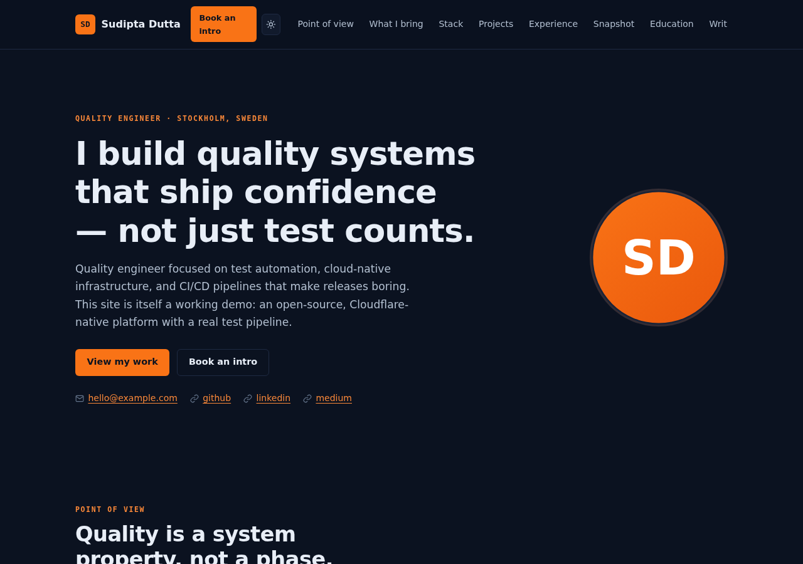

# Portfolio Platform

[](https://github.com/sudiptad1978/portfolio/actions/workflows/ci.yml)
[](LICENSE)

**An open-source, Cloudflare-native portfolio platform for QA & dev professionals.**
Astro (SSR on Workers) · Cloudflare Pages · D1 · KV · R2 · Cron Triggers · GitHub Actions.

The pipeline is the demo: every pull request runs lint → types → unit → build → **end-to-end browser tests** → **axe accessibility gates** → **Lighthouse performance budgets** before it can deploy.



---

## Why this exists

Most portfolio templates couple your content to their markup. This one separates them:

- **Identity & content live in one validated file** — `config/site.config.ts` (Zod-checked at build time; malformed config fails the build with a readable error).
- **Zero-database fork path** — `clone → npm install → edit config → npm run dev` works with **no D1/KV/R2 provisioning**. The database layer is _additive_, for blog syndication and the contact form.
- **Cloudflare-native by design** — static-first HTML with SSR only where it earns its keep, KV cache-aside reads, a cron Worker for RSS/Medium syndication, Turnstile-protected contact form.

Full technical blueprint: [`docs/ARCHITECTURE.md`](docs/ARCHITECTURE.md).

## Features

| Area              | What you get                                                                                                                                                        |
| ----------------- | ------------------------------------------------------------------------------------------------------------------------------------------------------------------- |
| **Content model** | All sections (POV, capabilities, stack, projects, experience, snapshot, education, blog, contact) render from config + content collections — never from markup      |
| **Themes**        | 4 pure-CSS token sets: `minimal`, `modern`, `terminal`, `professional` — switchable via one config value, each with light/dark variants                             |
| **Templates**     | 4 section-order presets: `developer`, `qa-engineer`, `sdet`, `technical-lead` — same components, different narrative emphasis                                       |
| **Mode switcher** | Light / Dark / System, pre-paint resolution (no flash), persisted in `localStorage`                                                                                 |
| **Blog**          | Markdown content collection (build-time) **merged with** D1-synced posts (cron Worker, every 6h) — new syndicated posts are live without a rebuild                  |
| **Syndication**   | Medium RSS + arbitrary RSS/Atom feeds → sanitize (strict allow-list) → dedupe (`UNIQUE(source, external_id)`) → D1 → KV invalidation, with a `sync_log` audit trail |
| **Contact form**  | Native form (works without JS) + fetch enhancement, Zod validation, KV rate limiting, Turnstile verification, D1 persistence                                        |
| **SEO**           | OG/Twitter cards, canonical URLs (syndicated posts stay canonical to the source), JSON-LD `Person` + `BlogPosting`, generated `sitemap.xml` + `robots.txt`          |
| **Security**      | Strict CSP (hashed pre-paint script, no `unsafe-inline` for scripts), HSTS, nosniff, frame-ancestors none, prepared statements only, IP hashing                     |
| **Health**        | `GET /api/health` with per-binding status for synthetic monitoring + post-deploy smoke tests                                                                        |

## Quickstart (5 minutes, zero database)

**Prerequisites:** Node ≥ 20, npm.

```bash
git clone https://github.com/sudiptad1978/portfolio.git
cd portfolio
npm install
npm run dev          # http://localhost:4321
```

Edit `config/site.config.ts` — name, role, socials, experience, projects, theme, template. Zod validates it on every build; a typo fails fast with a field-level error.

Useful commands:

```bash
npm run build        # production build → dist/
npm run preview:cf   # production-shaped local preview (wrangler pages dev + local bindings)
npm run doctor       # advisory pre-flight: bindings, env, node version
npm run test         # unit tests (Vitest)
npm run test:e2e     # browser tests (Playwright) — boots the local preview automatically
npm run test:a11y    # axe accessibility gate
npm run lint         # Prettier check
npm run typecheck    # astro check
```

## Deploying to Cloudflare (free tier)

### 1. Static-only path (no database — works immediately)

```bash
npm run build
npx wrangler pages deploy dist --project-name=portfolio
```

You get a fully working site on `*.pages.dev`. Done.

### 2. Full platform (D1 + KV + R2 + cron sync + contact form)

```bash
wrangler login

# Provision resources (paste returned IDs into wrangler.toml AND workers/wrangler.toml)
wrangler d1 create portfolio-db
wrangler kv namespace create CACHE
wrangler r2 bucket create portfolio-media

# Schema
npm run db:migrate:remote          # applies db/migrations/*.sql

# Secrets
wrangler pages secret put TURNSTILE_SECRET_KEY
wrangler pages deploy dist --project-name=portfolio

# Blog syndication cron worker (every 6h) — separate deployable
wrangler secret put MEDIUM_RSS_URL --config workers/wrangler.toml
npm run deploy:sync-worker
```

Run `npm run doctor` to verify nothing is left as a placeholder.

**Contact form bot protection:** create a Turnstile widget at
<https://dash.cloudflare.com> → Turnstile (domains: `localhost` + your domain),
then set `PUBLIC_TURNSTILE_SITE_KEY` (build time, in `.env`) and
`TURNSTILE_SECRET_KEY` (runtime secret). Without the secret, submissions are
accepted with `turnstile_verified = 0` — fine for local dev, not for production.

## CI/CD

`.github/workflows/ci.yml` (trunk-based, PRs + `main`):

```
PR / push
  → lint (Prettier) → typecheck (astro check) → unit (Vitest) → build
  → e2e (Playwright) → a11y (axe) → Lighthouse CI budgets
  → [PR]      deploy to Pages preview
  → [main]    D1 migrations → deploy to Pages production → smoke tests
```

**Required repo secrets** (scoped, never account-wide):

| Secret                  | Scope                                     |
| ----------------------- | ----------------------------------------- |
| `CLOUDFLARE_API_TOKEN`  | Pages:Edit, D1:Edit, Workers Scripts:Edit |
| `CLOUDFLARE_ACCOUNT_ID` | —                                         |

**Required repo environments:** `production` (protect it; PRs from forks never
see production secrets — don't override with `pull_request_target`).

`.github/workflows/blog-sync.yml` deploys the cron Worker when its code changes.

## Architecture

```
Browser → Cloudflare CDN → Pages (Astro SSR on Workers)
                              ├── prerendered: /, /blog, /404, robots.txt
                              ├── dynamic:     /blog/[slug], /api/{health,contact,blog}, /sitemap.xml
                              ├── D1  (blog cache, contact submissions, sync_log)
                              ├── KV  (latest-posts cache, rate-limit counters)
                              └── R2  (media)
Cron Worker (every 6h) → fetch Medium/RSS → sanitize → upsert D1 → invalidate KV
```

Data flow details, schema, decisions, and the phased roadmap: [`docs/ARCHITECTURE.md`](docs/ARCHITECTURE.md).

### Implementation notes (deviations from the blueprint, deliberate)

- **Cron Triggers** are not supported by Pages Functions, so the blog-sync Worker deploys separately (`workers/wrangler.toml`), bound to the same D1/KV.
- **Sanitizer** is an in-house, unit-tested allow-list (`src/lib/sanitize.ts`) chosen for edge compatibility; swap in a battle-tested library if you syndicate high-volume untrusted feeds.
- **Sitemap** is a custom dynamic endpoint (not `@astrojs/sitemap`) so D1-synced posts are included immediately.
- **Scripts are forced external** (`vite.build.assetsInlineLimit: 0`) so the strict CSP (`script-src 'self'` + one hash for the pre-paint snippet) holds. If you edit the pre-paint script in `BaseLayout.astro`, regenerate its hash: `npm run build && node scripts/csp-hash.mjs` → paste into `public/_headers`.
- **ESLint** is not wired yet (Prettier + `astro check` gate CI today) — tracked in the roadmap.
- **Astro CSRF protection** (`security.checkOrigin`, on by default) blocks cross-site form-style POSTs — that's the `403` your API tests will see without an `Origin` header.

## Configuration reference

Everything lives in **`config/site.config.ts`** — see the Zod schema in the same
file for the authoritative, self-documenting contract. Highlights:

| Field                                                                             | Purpose                                                            |
| --------------------------------------------------------------------------------- | ------------------------------------------------------------------ |
| `name`, `role`, `headline`, `bio`, `email`, `url`, `avatar`                       | Identity + SEO                                                     |
| `theme`                                                                           | `minimal` \| `modern` \| `terminal` \| `professional`              |
| `template`                                                                        | `developer` \| `qa-engineer` \| `sdet` \| `technical-lead`         |
| `accent`                                                                          | Optional hex override; a WCAG-safe contrast color is auto-computed |
| `sections`                                                                        | Optional explicit section order (overrides the template preset)    |
| `social`, `bookingUrl`                                                            | Links (Cal.com etc. — don't reinvent booking)                      |
| `pov`, `capabilities`, `stack`, `projects`, `experience`, `snapshot`, `education` | Content                                                            |
| `blog.canonicalToSource`                                                          | Keep syndicated posts canonical to the original (SEO-safe default) |

Blog posts (the zero-database ones) are markdown files in `src/content/blog/`.

## Roadmap

- [x] Phase 1–2 — Astro + Cloudflare foundation, config-driven sections
- [x] Phase 3 — Theme + template engine (4 × 4)
- [x] Phase 4 — D1 schema/migrations, KV cache-aside, contact API
- [x] Phase 5 — Blog syndication cron Worker (verified end-to-end locally)
- [x] Phase 6 — Vitest, Playwright e2e, axe a11y, Lighthouse CI wiring
- [x] Phase 7 — GitHub Actions preview/prod pipeline
- [x] Phase 8 — Turnstile, CSP/headers, rate limiting
- [ ] Phase 9 — Production cutover + custom domain + monitoring
- [ ] Phase 10 — Open-source polish (ESLint, R2 image pipeline, runtime theme picker, testimonials section)

## Contributing

See [CONTRIBUTING.md](CONTRIBUTING.md). Security reports: [SECURITY.md](SECURITY.md).

## License

[MIT](LICENSE) © Sudipta Dutta. Fork it, ship your own, keep the badge green.
